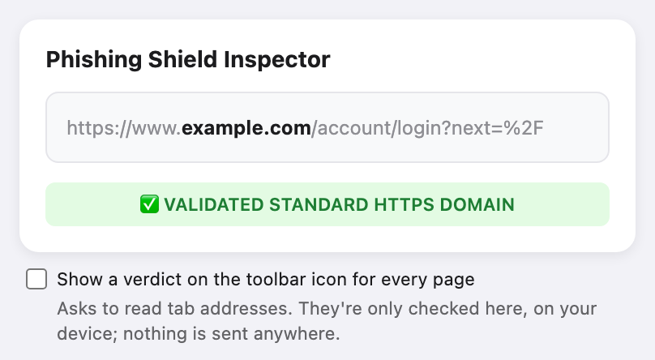
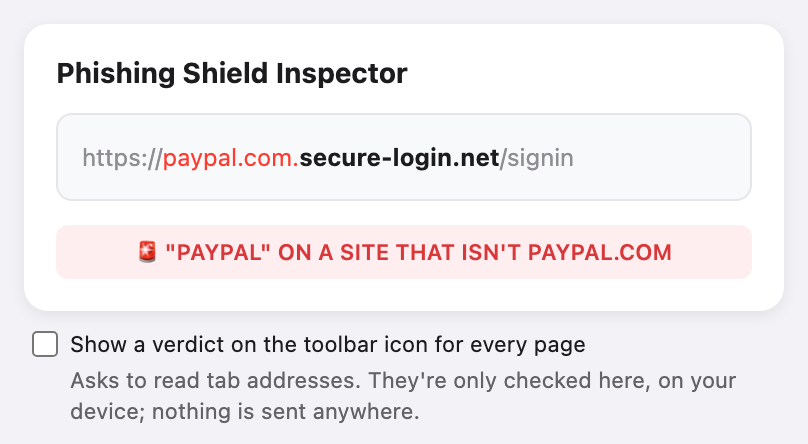
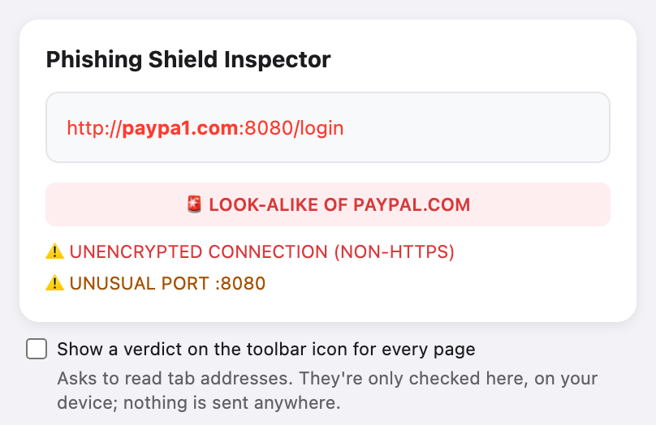
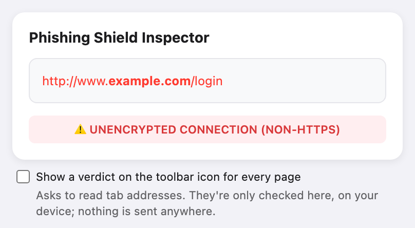
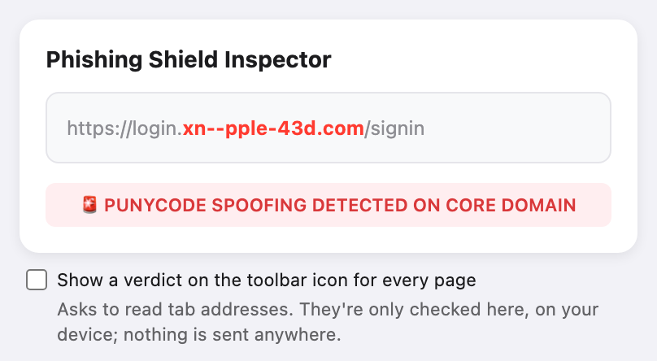
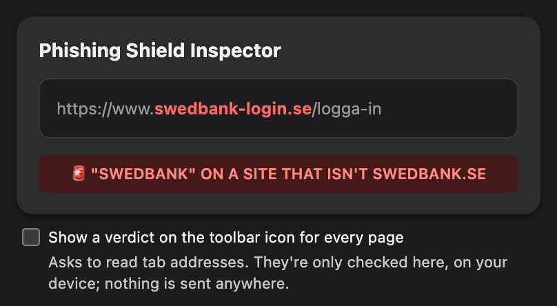

# 🛡️ Phishing Shield

A lightweight browser extension that inspects the URL of the active tab and highlights signs of phishing or domain-spoofing — look-alikes of well-known brands, brand names on sites the brand doesn't own, logins hidden before `@`, unencrypted connections, raw IP addresses, unusual ports, punycode homograph attacks, and suspicious characters in the core domain. Optionally, it shows a verdict on the toolbar icon for every page.

## Screenshots

| Valid HTTPS domain | Brand name on someone else's domain | Look-alike, with more findings |
|---|---|---|
|  |  |  |
| **Unencrypted connection** | **Punycode look-alike** | **Dark mode** |
|  |  |  |

## Description

Phishing Shield is a minimal browser-extension "inspector" that helps users quickly sanity-check the address bar of the page they're currently viewing. Instead of trusting the URL at a glance, it parses the hostname, isolates the **registrable (main) domain** from subdomains, and visually distinguishes the two — making it much harder for a spoofed subdomain (e.g. `paypal.com.security-check.example`) to blend in with the real domain. It also knows ~70 brands that phishing often impersonates (global and Swedish), and flags look-alikes of them.

## How It Works

When the popup is opened, `popup.js` gets the active tab's URL via `chrome.tabs.query` and hands it to `lib/analyze.js`, which:

1. **Parses the URL** using the built-in `URL` object (hostname, protocol, login part, port, path, query).
2. **Skips pages that aren't websites.** Browser pages (`chrome://`, `edge://`), local files (`file://`), extension pages and `about:blank` get a grey `NOT A WEBSITE (… PAGE): NOTHING TO CHECK` badge instead of a false alarm.
3. **Splits the hostname into subdomain + registrable domain** using the bundled [Public Suffix List](https://publicsuffix.org/) (`lib/psl-data.js`, ICANN and private domains):
   - `secure.bank.co.uk` → `bank.co.uk`; `shop.example.pp.se` → `example.pp.se`.
   - On **shared hosting** (`github.io`, `netlify.app`, `pages.dev`, `s3.amazonaws.com` and thousands more) the site owner's own label is part of the highlighted domain: `paypal-login.github.io`, because anyone can create a site there.
   - Handles a trailing dot (`www.example.com.`, a valid fully qualified name) so it can't shrink the highlighted domain to `com.`.
   - Leaves IP addresses (IPv4, and bracketed IPv6 such as `[::1]`) untouched.
4. **Runs the checks** below on `http://` and `https://` URLs. Every finding is listed: the most serious one becomes the headline badge, the rest appear under it.

   | Check | Level | What it catches |
   |---|---|---|
   | **Login before `@`** | 🚨 | `https://paypal.com@evil.example` reads as paypal.com at a glance; the real site is after the `@`. |
   | **Raw IP host** | 🚨 | Pages whose host is an IP address instead of a domain name. |
   | **Punycode on the main domain** | 🚨 | A main domain starting with `xn--`, a common sign of an IDN homograph attack (e.g. a Cyrillic look-alike character). A punycode top-level domain on its own (e.g. `.xn--p1ai`, Russia's `.рф`) is not flagged. |
   | **Brand look-alike** | 🚨 | A domain that passes for a brand's: look-alike characters (`paypa1`, `micros0ft`, `arnazon` with *rn* for *m*), an adjacent swap (`netfilx`), or one typo in a name of 8+ letters (two from 11: `handelsbankem`). |
   | **Brand name on someone else's site** | 🚨 | A brand name used in a domain the brand doesn't own: `paypal.com.secure-login.net`, `swedbank-login.se`, `paypalsecure.com`. Brand names that are ordinary words (apple, chase, swish) only count next to a phishing word such as *login* or *verify*. |
   | **Domain characters** | 🚨 | Characters the URL parser lets through in the main domain, such as `_` (`pay_pal.com`). Non-ASCII letters are already turned into punycode by the parser. |
   | **Punycode in a subdomain** | 🚨 | `xn--pypal-4ve.example.com`: a look-alike in front of a real domain. |
   | **HTTPS** | 🚨 | Any page not served over `https://`. |
   | **Brand name on an unexpected ending** | ⚠️ | `paypal.support`, `swedbank.co`. A brand's country domains (`amazon.de`, `google.se`) are accepted, except on endings mostly rented out generically (`.co`, `.io`, `.tk`, …). |
   | **Unusual port** | ⚠️ | `https://example.com:8443`; real sites rarely use one. |

5. **Renders a colour-coded breakdown of the URL**: protocol, subdomain and path dimmed, the registrable domain in bold, and the parts behind a finding in red or orange. The URL is built with `createElement` and `textContent` only, never `innerHTML`, so a malicious page URL cannot inject markup into the popup itself.

### Toolbar verdict (opt-in)

Tick **Show a verdict on the toolbar icon for every page** in the popup to get a badge on the extension icon as you browse: red `!` for danger, orange `!` for a warning, green `✓` when nothing was found. It needs the browser's optional **tabs** permission ("Read your browsing history"), which is only requested when you tick the box and removed again when you untick it. `background.js` runs the same checks as the popup, on your device only: no URL is stored or sent anywhere.

## Privacy

No network requests, no remote code, no tracking. Installing asks only for `activeTab` (the current tab's URL, when you open the popup). The Public Suffix List and the brand list are bundled with the extension.

## Project Structure

```
Phishing-Shield/
├── manifest.json        # Manifest V3: popup, activeTab, optional tabs, service worker
├── popup.html           # Popup markup
├── popup.css            # Popup styling (light and dark tokens)
├── popup.js             # Popup: renders lib/analyze.js's result, toolbar-verdict toggle
├── background.js        # Opt-in toolbar verdict (service worker)
├── lib/
│   ├── analyze.js       # The checks: analyzeUrl(url) -> { level, findings, parts }
│   ├── brands.js        # Brands phishing impersonates, with their real domains
│   └── psl-data.js      # Public Suffix List (generated, MPL-2.0)
├── scripts/
│   └── update-psl.mjs   # Regenerates lib/psl-data.js (npm run update-psl)
├── icons/               # icon.svg and its 16/32/48/128 px PNGs
├── tests/
│   └── popup.test.mjs   # Runs the popup and background scripts against fake tabs (node --test)
├── docs/screenshots/    # README images
├── eslint.config.mjs    # ESLint (dev-only), incl. the no-unsanitized rule
├── package.json         # Dev tooling only: npm test, npm run lint, npm run update-psl
└── .github/workflows/   # CI: lint + tests
```

## Development

```sh
npm ci                # dev-only tools (ESLint); the extension itself has no dependencies
npm run lint
npm test
npm run update-psl    # refresh the Public Suffix List now and then; review the diff and commit
```

## Installation

1. Open `chrome://extensions` (or the equivalent page in your Chromium-based browser).
2. Enable **Developer mode**.
3. Click **Load unpacked** and select the project folder.
4. Pin the extension and click its icon on any page to inspect the current URL.

## Limitations & Disclaimer

This tool applies simple, client-side heuristics and is intended as a **quick visual aid**, not a definitive security verdict. It does **not**:

- Check domains against blocklists/reputation services.
- Know every brand: the list in `lib/brands.js` covers ~70 often-impersonated ones. Look-alike matching is tuned to avoid false alarms on ordinary words, so one changed letter in a short name (`spotity` for `spotify`) isn't caught.
- Detect all forms of phishing (e.g. malicious content hosted on a legitimate-looking, otherwise valid domain, or on a hacked real site).
- Replace browser-native phishing/malware protection.

Always exercise caution with unfamiliar links, regardless of what this extension reports.

## License

This project is licensed under the MIT License — see the [LICENSE](LICENSE) file for details.

`lib/psl-data.js` is derived from the [Public Suffix List](https://publicsuffix.org/) and is subject to the [Mozilla Public License 2.0](https://mozilla.org/MPL/2.0/).
